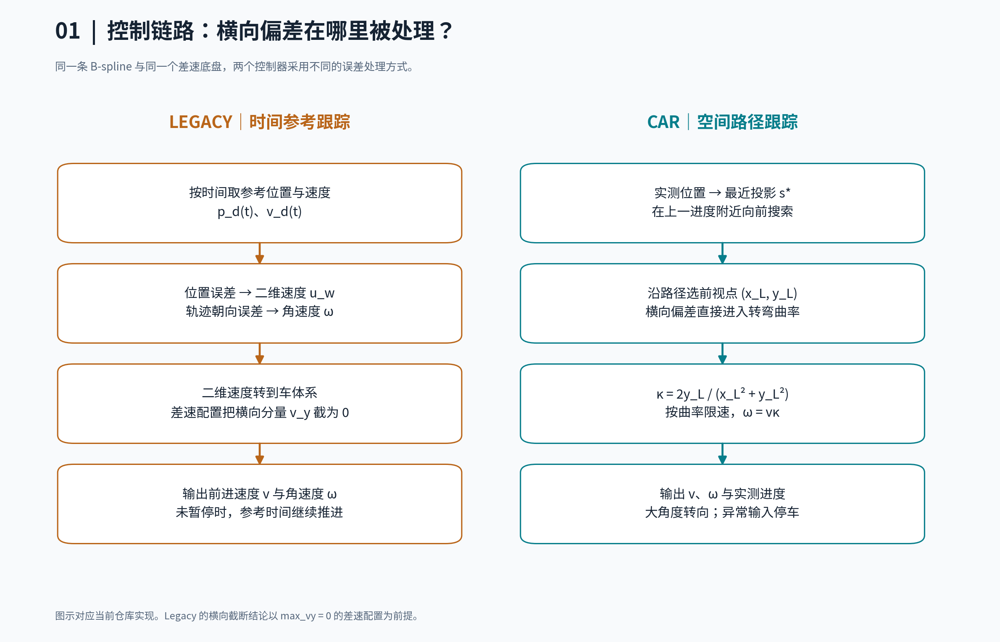
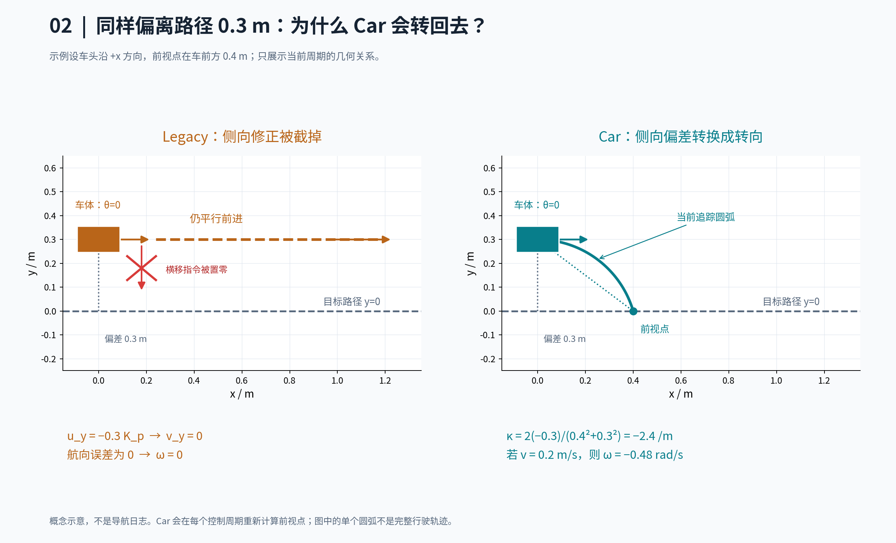
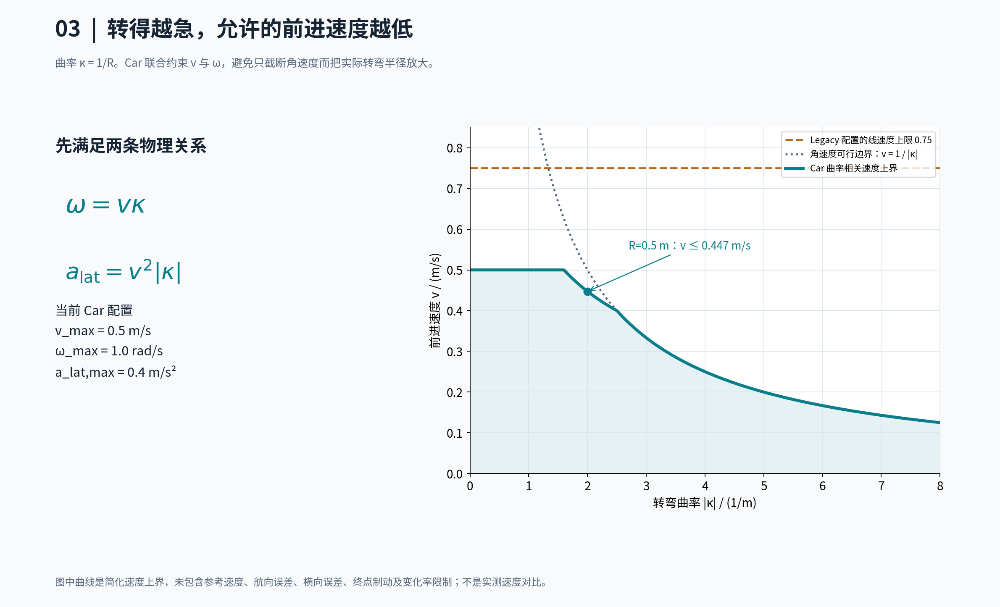
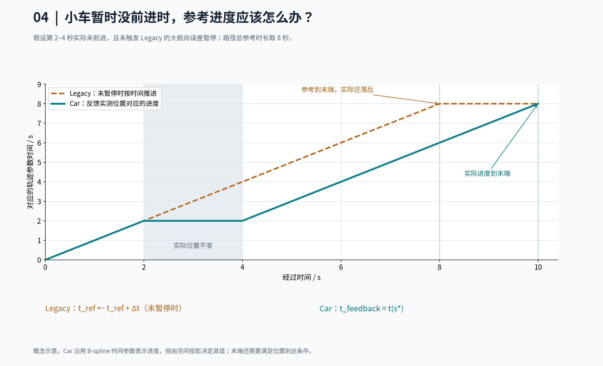

# Car 与 Legacy 控制器：差速小车为什么需要这样跟踪路径

本文对应当前仓库的 `closed_loop_controller.cpp`（Legacy）与
`closed_loop_controller_car.cpp`（Car），以及 `controllers.yaml` 中的默认配置。
这里的结论针对这两个具体实现。

**Legacy 按时间追参考位置和速度，位置误差先变成二维速度；Car 根据实际位置选前视点，把横向偏差变成转向，再按转弯需求限制车速。**
两者都读取实际位姿，都是闭环控制。区别在于误差怎样进入控制指令，以及执行进度怎样推进。

## 1. 先看控制链路



[下载矢量图 SVG](images/controller_comparison/01_control_flow.svg)

| 对比项 | Legacy | Car |
| --- | --- | --- |
| 跟踪参考 | 当前执行时间对应的位置、速度 | 实际位置的路径投影及空间前视点 |
| 横向偏差处理 | 先形成横移速度；当前 `max_vy=0` 会截掉它 | 进入追踪曲率，改变角速度 |
| 转向依据 | 参考轨迹前向弦的朝向与车头之差 | 车体到前视点的方位角与追踪曲率 |
| 速度与转向 | 分别计算、分别限幅 | 通过曲率联合约束，角速度变化受限时进一步减速 |
| 大角度处理 | 超过单阈值时原地转向并暂停计时 | 原地转向，进入/退出使用不同阈值 |
| 执行进度 | 未暂停时按时间累加 | 实测位置投影得到参数时间，反馈给规划 FSM |
| 平移能力 | 支持配置 `linear.x`、`linear.y`，允许负向 x 速度 | 只输出非负 `linear.x`，`linear.y=0` |

Legacy 中的二维速度控制对具有横移能力的平台有意义。用于差速底盘时，
横移分量不能执行，便需要通过转向来补偿这部分偏差。Car 的几何跟踪正是围绕这个约束设计的。

## 2. 共同基础：差速运动学

设车在规划坐标系中的位置为 $p=(x,y)^T$，车头航向为 $\theta$，控制量为前进速度 $v$ 和角速度 $\omega$：

$$
\dot x=v\cos\theta,\qquad
\dot y=v\sin\theta,\qquad
\dot\theta=\omega.
$$

车体不能直接沿侧面移动。若轮距为 $b$，理想左右轮线速度满足：

$$
v_R=v+\frac{b\omega}{2},\qquad v_L=v-\frac{b\omega}{2}.
$$

这两个节点发布的是 `cmd_vel`；轮速换算由底盘执行层负责。
在车体坐标中，x 向前、y 向左；正角速度表示逆时针左转。

| 符号 | 含义 |
| --- | --- |
| $p_d(t),\dot p_d(t)$ | B-spline 的参考位置、参考速度 |
| $R(\theta)$ | 从车体坐标到规划坐标的二维旋转矩阵 |
| $s$ | 对采样路径累计得到的弧长 |
| $s^*$ | 当前实际位置在局部路径上的投影进度 |
| $e_c$ | 实际位置到投影点的距离 |
| $(x_L,y_L)$ | 前视点在车体坐标中的位置 |
| $\alpha$ | 前视点相对车头的方位角 |
| $\kappa$ | 当前控制周期要求执行的追踪圆弧曲率 |
| $\operatorname{clip}$ | 把数值限制在上下界内；`wrap` 把角度归一化到主值区间 |

## 3. Legacy：位置误差进入速度，朝向误差进入转向

### 3.1 平移控制

令 $e_p=p_d(t)-p$，先在规划坐标系中计算二维期望速度：

$$
u_w=\operatorname{clipNorm}\left(\dot p_d(t)+K_p e_p,\;\max(v_{x,\max},v_{y,\max})\right).
$$

`clipNorm` 限制整个向量的模长。随后转换到车体坐标并分别限幅：

$$
u_b=R(\theta)^Tu_w,\qquad
v_x=\operatorname{clip}(u_{b,x},-v_{x,\max},v_{x,\max}),\qquad
v_y=\operatorname{clip}(u_{b,y},-v_{y,\max},v_{y,\max}).
$$

当前配置 $v_{y,\max}=0$，因此 $v_y=0$。
横向位置误差虽然参与了 $u_w$ 的计算，但其落在车体 y 方向的修正分量无法执行。

### 3.2 航向控制

向前看一段**参数时间** $T_f$，用参考路径上的两点确定期望朝向：

$$
q=p_d(\min(t+T_f,T_{end}))-p_d(t),\qquad
\psi_d=\operatorname{atan2}(q_y,q_x),
$$

$$
e_\psi=\operatorname{wrap}(\psi_d-\theta),\qquad
\omega=\operatorname{clip}(K_\psi e_\psi,-\omega_{\max},\omega_{\max}).
$$

两参考点过近时退回参考速度方向；速度也过小时使用当前航向。
关键是：这个角速度公式没有直接使用实际位置的横向偏差。

若 $|e_\psi|>0.8\ \mathrm{rad}$（约 $45.8^\circ$），停止平移、原地转向并暂停执行时间；
否则执行时间按 $t\leftarrow t+\Delta t$ 推进。
参考时间走到末端且位置误差小于 `finish_dist` 时停止。

## 4. 一个直观例子：方向正确，但位置偏了



[下载矢量图 SVG](images/controller_comparison/02_lateral_correction.svg)

假设目标路径是水平直线 $y=0$，车在 $(0,0.3)$，车头朝向 $\theta=0$。
参考速度沿 +x 方向，期望航向也为 0，并假设此时没有触发速度模长限幅。

Legacy 会产生向下的修正分量 $u_y=-0.3K_p$，但差速配置把它截为零；
同时 $e_\psi=0$，于是 $\omega=0$。
在这个理想直线例子里，车可能保持偏离状态、继续平行行驶。
弯曲路径、扰动或其他初始状态下行为会不同，这个例子用于说明横向纠偏缺口。

Car 若选到规划坐标中的前视点 $(0.4,0)$，该点在车体坐标中为 $(0.4,-0.3)$：

$$
\kappa=\frac{2(-0.3)}{0.4^2+0.3^2}=-2.4\ \mathrm{m}^{-1}.
$$

若当前周期能够输出 $v=0.2\ \mathrm{m/s}$，则 $\omega=v\kappa=-0.48\ \mathrm{rad/s}$，
即向右转回路径。实际输出还受加速度等限制；图中的圆弧只代表这一周期的追踪几何。

## 5. Car：把路径变成差速车能执行的圆弧

### 5.1 先找实际进度，再选前视点

Car 按 `sample_dt=0.03 s` 对 B-spline 采样，累计相邻点距离得到弧长，
并保存每个点的参考时间与参考速度。在折线段上投影：

$$
s^*=\arg\min_{s\in[s_{prev},\;\min(s_{prev}+d_{search},s_{end})]}
\|p_{path}(s)-p\|,\qquad e_c=\|p_{path}(s^*)-p\|.
$$

这里在上一次进度附近向前搜索，默认 $d_{search}=1.0\ \mathrm m$，
同一条轨迹内的进度不会倒退，减少交叉路径上跳到远处段落的问题。
新轨迹到来时重新建立投影进度。

空间前视距离随上周期指令速度变化：

$$
L_d=\operatorname{clip}(L_{min}+T_Lv_{prev},L_{min},L_{max}),\qquad
s_L=\min(s^*+L_d,s_{end}),
$$

$$
\begin{bmatrix}x_L\\y_L\end{bmatrix}
=R(\theta)^T\left(p_{path}(s_L)-p\right),\qquad
\alpha=\operatorname{atan2}(y_L,x_L).
$$

### 5.2 用前视点求曲率

$$
\boxed{\kappa=\frac{2y_L}{\max(x_L^2+y_L^2,10^{-6})}},\qquad
\boxed{\omega=v\kappa}.
$$

前视点在左边，$y_L>0$，就左转；在右边就右转。
这样横向偏差能直接改变角速度。

注意分母是**车到前视点的欧氏距离平方**，不能直接替换成上面的 $L_d^2$：
$L_d$ 是沿路径量取的弧长，而且车可能已经偏离路径。
当前实现使用纯追踪所需的曲率限速，没有使用参考样条的解析曲率，
以避免参考速度接近零时曲率计算病态影响末端跟踪。

### 5.3 转得越急，速度越低



[下载矢量图 SVG](images/controller_comparison/03_curve_speed_limits.svg)

由 $|\omega|=v|\kappa|$、横向加速度 $a_{lat}=v^2|\kappa|$，得到：

$$
v\le\frac{\omega_{max}}{|\kappa|},\qquad
v\le\sqrt{\frac{a_{lat,max}}{|\kappa|}}.
$$

代码先取 $v_0=\min(v_{max},\max(0.08,v_{ref,L}))$，再结合上述两条限制。
随后按前视角与横向误差继续降速：

$$
v_1=\min\left(v_0,\frac{\omega_{max}}{|\kappa|},
\sqrt{\frac{a_{lat,max}}{|\kappa|}}\right)
\frac{\max(0,\cos\alpha)}{1+g_e e_c},\qquad g_e=1\ \mathrm{m}^{-1}.
$$

曲率接近零时跳过除以曲率的两项。$g_e$ 是对代码 `1.0 + best_distance` 的量纲化表达，
当前没有单独的配置参数。参考速度的 0.08 m/s 下限只用于初始选速，后续仍可降低至零。

例如 $R=0.5\ \mathrm m$，$|\kappa|=2\ \mathrm{m}^{-1}$，当前配置给出：

$$
v\le\min(0.5,1/2,\sqrt{0.4/2})\approx0.447\ \mathrm{m/s}.
$$

图中的 Legacy 虚线是其**配置线速度上限**，不是实际输出曲线。
两者默认最大速度也不同，因此不能把图当作同参数性能测试。

### 5.4 转向、变化率与停车

- 当 $|\alpha|>0.7\ \mathrm{rad}$（约 $40.1^\circ$）时先原地转向；
  进入后直到 $|\alpha|\le0.25\ \mathrm{rad}$（约 $14.3^\circ$）才退出。
  两个阈值形成滞回，减少反复切换。
- 原地转向使用 $\omega_{des}=\operatorname{clip}(K_{rotate}\alpha,\pm\omega_{max})$，
  并限制角速度变化率。
- 正常跟踪对速度与角速度施加变化率限制。
  如果角速度尚未增长到 $v\kappa$，进一步降低前进速度；角速度方向与所需曲率相反时先不前进。
  这能减少转向响应跟不上、车却继续向前冲的问题。
- 剩余弧长小于 $2L_d$ 时，额外限制
  $v\le\min(\sqrt{2a_{decel}d_{goal}},\;0.8d_{goal})$，末项系数单位为 $\mathrm{s}^{-1}$。
- 到达要求同时满足：剩余弧长不超过 $2d_{finish}$，且到终点的直线距离不超过 $d_{finish}$。
  当前不要求末端朝向对齐。

变化率限制是正常跟踪的平滑措施；曲率约束、原地转向切换和故障停车可要求更快降低速度，
不能把 `max_decel` 理解成所有情况下都严格遵守的减速度上限。

## 6. 为什么还要把实际进度反馈给规划器



[下载矢量图 SVG](images/controller_comparison/04_execution_progress.svg)

Legacy 在没有触发暂停时按经过时间推进。若车因限速或执行偏差落后，
参考点仍可能向前走；它对大航向误差的暂停能够缓解部分情况，但不覆盖所有未前进的原因。

Car 把投影弧长映射回样条参数时间：

$$
t_{feedback}=t(s^*),\qquad
t_{start,FSM}=t_{now}-t_{feedback}.
$$

通过 `planning/execution_progress` 把轨迹 ID、参数时间、到达和跟踪丢失状态传给 FSM。
规划器由此根据实际推进情况处理剩余轨迹与重规划。
它仍然保留 B-spline 的时间参数，只是推进依据来自空间投影。

LIO launch 在 Car 模式下自动启用 `fsm.use_controller_progress=true`。
反馈需匹配当前轨迹 ID 且有效、新鲜；缺失或超时时暂停推进。
尚未满足到达条件时，FSM 避免把进度直接置为轨迹结束。
**只单独替换控制器节点而没有接通这个反馈，不能获得完整的进度同步行为。**

图中停车两秒是概念情形，不是实测日志；假设没有触发 Legacy 的航向暂停。

## 7. 默认参数对照与使用边界

参数来源：[controllers.yaml](../src/planning/local/SCAN-Planner/src/planner/plan_manage/config/controllers.yaml)。

| 参数/行为 | Legacy | Car |
| --- | --- | --- |
| 最大前进速度 | 0.75 m/s | 0.5 m/s |
| 最大角速度 | 1.0 rad/s | 1.0 rad/s |
| 横向速度上限 | 0，横移被截断 | 始终不输出横移 |
| 位置/航向比例增益 | 0.8 / 1.5 | 转向增益 1.5；正常跟踪采用纯追踪几何 |
| 前视量 | 0.8 s 的参考时间 | 0.25–0.6 m，随速度变化 |
| 原地转向阈值 | 0.8 rad，单阈值 | 进入 0.7 / 退出 0.25 rad |
| 到达距离容差 | 0.15 m | 0.1 m，并检查剩余弧长 |
| 正常加速/减速限制 | 未显式设置 | 0.5 / 0.8 m/s² |
| 角加速度限制 | 未显式设置 | 2.0 rad/s² |
| 横向加速度限速参数 | 未显式设置 | 0.4 m/s² |
| 跟踪偏差超限 | 持续按原控制律跟踪 | 超过 0.8 m 停车，反馈跟踪丢失请求重规划 |
| 里程计检查 | 没有 Car 的完整新鲜度/坐标系检查 | 0.5 s 超时、坐标系/数值异常时停车 |
| 常量急停轨迹 | 原控制流程处理 | 作为保持指令停车，不驱车追赶保持点 |

对于当前差速小车，建议使用 Car。Legacy 可用于对照实验，也可在平台支持横移时配置其二维输出。
对照时应统一最大速度、到达容差、输入路径和定位条件，再比较横向误差与速度变化。

Car 不会替规划器选择绕障左侧还是右侧，也不会自行检测障碍物。
路径在重规划中频繁换侧、TF 不一致、定位跳变、底盘响应滞后或轮胎打滑，都可能继续影响导航。
前视距离过大会切弯，过小可能对路径和位姿噪声更敏感。
当前 Car 只前进，不实现倒车规划、轮速闭环或末端姿态控制。

## 8. 运行与代码入口

已有依赖和工作空间构建完成后，当前集成入口为：

```bash
source /opt/ros/humble/setup.bash
source install/setup.bash
./scripts/nav2_scan_seg.sh 0
```

该脚本已经选择 Car。手动运行 LIO launch 时，可在相同输入配置下选择：

```bash
# Car；运行前先启动对应的仿真、定位与去地面节点
ros2 launch scan_planner scan_planner_lio_launch.py \
  controller_type:=car use_sim_time:=true \
  body_pose_topic:=/ground_seg/odom sensor_pose_topic:=/ground_seg/odom \
  cloud_topic:=/no_ground_cloud cloud_is_world:=true
```

换成 `controller_type:=legacy` 即可对照；切换前停止原 launch，避免两个控制器同时发布 `cmd_vel`。
这里假设 GroundSeg 使用集成脚本的配准点云模式，`/no_ground_cloud` 已在 `odom` 系。
只在外部底盘控制器不接管同一话题时使用这一输出。
编译、接口与验证说明见 [差速控制器说明](scan_car_controller.md)。

代码索引：

- [Legacy 节点](../src/planning/local/SCAN-Planner/src/planner/plan_manage/src/closed_loop_controller.cpp)：时间参考、二维位置反馈与朝向反馈。
- [Car 节点](../src/planning/local/SCAN-Planner/src/planner/plan_manage/src/closed_loop_controller_car.cpp)：轨迹接收、里程计检查、速度与进度发布。
- [CarPathTracker](../src/planning/local/SCAN-Planner/src/planner/plan_manage/include/plan_manage/car_path_tracker.h)：投影、前视、曲率、限速和到达判定。
- [LIO launch](../src/planning/local/SCAN-Planner/src/planner/plan_manage/launch/scan_planner_lio_launch.py)：控制器选择与进度反馈开关。
- [规划 FSM](../src/planning/local/SCAN-Planner/src/planner/plan_manage/src/scan_replan_fsm.cpp)：执行进度接收与规划状态处理。

## 9. 图片复用与生成

四组图片均提供 PNG 和 SVG。PNG 适合直接浏览，SVG 适合在汇报中缩放。
它们是根据代码关系绘制的解释图，不代表真实导航精度或性能测试结果。

生成脚本：[generate_controller_comparison_figures.py](tools/generate_controller_comparison_figures.py)。
需要 Python、NumPy、Matplotlib；中文字体优先使用 Noto Sans CJK：

```bash
python3 docs/tools/generate_controller_comparison_figures.py
```
