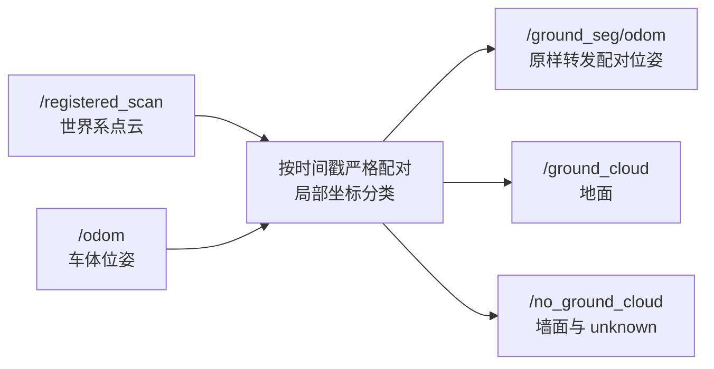

# GroundSeg：点云与位姿同步分割

ROS 2 Humble 功能包，包名保留为 `efficient_online_segmentation`。
使用 Efficient Online Segmentation 的扇区线段分割核心，提供两个入口。
**所有入口都不查询、不订阅、不发布 TF。**

## 两个入口

| 模式 | 可执行文件 | 输入 | 输出 |
| --- | --- | --- | --- |
| 同步模式（默认） | `ground_separation_node` | `PointCloud2` 点云＋`Odometry` 位姿 | 对应位姿＋地面点云＋非地面点云 |
| 单点云模式 | `cloud_only_segmentation_node` | 传感器坐标系 `PointCloud2` | 地面点云＋非地面点云 |

单点云模式不订阅位姿，不创建位姿发布者，不会推算或伪造位姿。
旧可执行文件名 `efficient_online_segmentation_node` 保留为单点云程序的兼容入口，
与 `cloud_only_segmentation_node` 使用同一份实现。旧的 EOS 着色、距离图和线段发布器已移除。

## 默认同步数据流



默认使用 `config/gazebo_mid360.yaml`，适配当前 `get_urdf/simple_car.urdf` 仿真模型。
两份点云与输出位姿具有完全相同的时间戳，点云输出到输入位姿的父坐标系（通常为 `odom`）。
位姿消息完整转发，包含 `child_frame_id`、pose、twist 和协方差；不会把车体位姿改成雷达位姿。
三份输出是独立 ROS 消息，依靠相同时间戳建立关联，不保证跨话题的原子到达顺序。

## 编译与运行

在工作空间根目录：

```bash
source /opt/ros/humble/setup.bash
source install/setup.bash
colcon build --packages-select efficient_online_segmentation
source install/setup.bash
```

同步模式：

```bash
ros2 launch efficient_online_segmentation ground_separation.launch.py \
  use_sim_time:=true cloud_topic:=/registered_scan odometry_topic:=/odom
```

当前 SCAN 集成入口：

```bash
./scripts/nav2_scan_seg.sh 0
```

SCAN 与 Car 控制器使用 `/ground_seg/odom`；SCAN 使用 `/no_ground_cloud` 和
`cloud_is_world:=true`。FAST-LIO 分支使用 `point_filter_num:=1 dense_publish_en:=true`，
使地面分类使用预处理抽点和匹配体素降采样之前的尽可能完整的有效点。
该包本身不会给稀疏点云补点，也不会把所有 unknown 都当作地面删除。

单点云模式，Gazebo 原始雷达输入：

```bash
ros2 launch efficient_online_segmentation cloud_only_segmentation.launch.py \
  use_sim_time:=true cloud_topic:=/livox/lidar
```

旧 launch 名称仍可进入同一个单点云程序：

```bash
ros2 launch efficient_online_segmentation efficient_online_segmentation.launch.py \
  use_sim_time:=true cloud_topic:=/livox/lidar
```

直接运行二进制时应提供参数文件。单点云二进制配合世界点云预设时，必须显式关闭世界系输入：

```bash
ros2 run efficient_online_segmentation cloud_only_segmentation_node --ros-args \
  --params-file "$(ros2 pkg prefix --share efficient_online_segmentation)/config/gazebo_mid360.yaml" \
  -p input_cloud_is_world:=false -p sub_cloud_topic:=/livox/lidar
```

## 坐标与外参约定

令 $T^W_B$ 为输入车体位姿，$T^B_L$ 为配置中的雷达在车体坐标系中的位姿。

- `odometry_is_sensor_pose=false`：位姿子坐标系必须为 `body_frame_id`，
  $T^W_L=T^W_BT^B_L$。
- `odometry_is_sensor_pose=true`：位姿子坐标系必须为 `sensor_frame_id`，输入直接提供 $T^W_L$。
- `input_cloud_is_world=true`：输入点云坐标系必须与位姿父坐标系相同；
  按 $p_L=(T^W_L)^{-1}p_W$ 分类，再直接筛选原始世界系点，保持坐标不变。
- `input_cloud_is_world=false`：输入点云坐标系必须为 `sensor_frame_id`；
  同步模式按 $p_W=T^W_Lp_L$ 输出世界系点；单点云模式输出仍为传感器系。

`kExtrinsicTrans`（米）与 `kExtrinsicRot`（行优先 3×3 矩阵）描述雷达在车体/地面参考系中的位姿。
分割核心把雷达点转到此车体参考系，依据坡度和离地高度分类。
该参考系应采用 z 向上、接近地面的原点；若车辆位姿原点位于高处，应先给出相应的地面参考位姿或调整输入适配。
当前 Gazebo 外参为 `[0, 0, 0.25] m`、单位旋转，来自车体 0.10 m 加雷达安装 0.15 m。
外参完全来自参数，必须与实际模型一致；本包不从 TF 自动查找外参。

单点云模式只接受传感器系点云，因为没有位姿就不能把移动的世界系点云转换回雷达局部坐标。
机器人 TF 仍由模型和定位节点维护；同步模式的世界系点云可在 RViz 的相同固定坐标系下直接显示。

## 话题与参数

| 参数 | 默认/预设 | 含义 |
| --- | --- | --- |
| `sub_cloud_topic` | `/registered_scan` | 点云输入；launch 中用 `cloud_topic` 覆盖 |
| `odometry_topic` | `/odom` | 同步模式的位姿输入 |
| `pub_odometry_topic` | `/ground_seg/odom` | 配对位姿输出 |
| `pub_ground_cloud_topic` | `/ground_cloud` | 地面点输出；launch 中用 `ground_topic` 覆盖 |
| `pub_no_ground_cloud_topic` | `/no_ground_cloud` | 非地面点输出；launch 中用 `nonground_topic` 覆盖 |
| `input_cloud_is_world` | `true` | 输入是否已在位姿父坐标系中 |
| `odometry_is_sensor_pose` | `false` | 输入位姿是否直接描述雷达 |
| `body_frame_id` | `base_footprint`（Gazebo） | 车体位姿的子坐标系 |
| `sensor_frame_id` | `livox_frame`（Gazebo） | 雷达坐标系 |
| `sync_queue_size` | 30 | 严格时间匹配缓存条数，范围 1–10000 |
| `verbose` | `false` | 是否输出分割核心每帧统计 |
| `use_sim_time` | launch 默认 `false` | Gazebo/rosbag 时按上游时钟配置 |

所有 YAML 使用同一个节点名 `ground_separation`，可以替换参数文件：

| 文件 | 传感器/用途 |
| --- | --- |
| `gazebo_mid360.yaml` | 当前 Gazebo 50×360 雷达模型，默认配置 |
| `robosense_airy.yaml` | Airy 96 线，翻转安装、2.07 m；需确认实际外参 |
| `segmentation_params.yaml` | HDL-32 示例，需按实际传感器校准 |
| `gazebo_mid360_sep.yaml` | Gazebo 旧文件名兼容预设，接口与默认预设一致 |
| `ground_separation.yaml` | Airy 旧文件名兼容预设，接口与 Airy 预设一致 |

分割参数以 `k` 开头；角度单位为度。`kLidarRows/Cols`、分辨率、FOV 与扇区数量
必须适配输入传感器。有 UINT16 `ring` 字段时使用 ring 分箱，否则使用仰角分箱。
Airy 单点云示例：

```bash
ros2 launch efficient_online_segmentation cloud_only_segmentation.launch.py \
  params_file:="$(ros2 pkg prefix --share efficient_online_segmentation)/config/robosense_airy.yaml" \
  cloud_topic:=/rslidar_points
```

输入订阅采用 SensorDataQoS（Best Effort、Volatile），接受可靠和尽力发布者；
点云输出为 Reliable/Volatile、深度 5，位姿输出深度 10。

## 同步、字段和异常处理

- 同步模式只接受 `header.stamp` 完全相同的两条消息。处理延迟可以不同，时间戳必须相同。
  不使用最新位姿替代、不按接收时刻重打时间戳；超出缓存的未配对消息会被丢弃。
  若上游点云和位姿时间戳本就不同，应在上游做插值并赋予同一采样时刻，不能仅打开仿真时间代替配对。
- 保留点的原始字段、字段类型、字节序与 point_step，包括 intensity、ring、time 等。
  世界系输入的点记录按原字节筛选；传感器系输入转换到世界系时只修改 XYZ。
  输出重排为无组织点云（height=1），输入的行末 padding 不保留。
- XYZ 支持 FLOAT32/FLOAT64，ring 若存在须为 UINT16。
  无 intensity 也可以分割；非有限 XYZ 点会丢弃，其他字段不用于地面判定且不改值。
- 空点云输出两份空点云，同步模式仍转发配对位姿。字段结构和时间戳保留。
- 非法位姿、坐标系不匹配、损坏的点云字段/数据长度：整帧不输出，并节流提示。
- 地面为 label=1；墙面和 unknown 均进入非地面输出，避免把未确认的障碍物当作地面。
- 本包不负责定位、点云去畸变、地图累积或障碍膨胀。

## 可视化

`rviz:=true` 可打开随包 RViz 配置，显示 `/ground_cloud`、`/no_ground_cloud`、`/ground_seg/odom`。
同步模式默认固定坐标系为 `odom`。单点云模式需把 Fixed Frame 改成传感器坐标系（如 `livox_frame`），
并关闭没有数据的位姿显示；无需为显示点云启动本包的 TF 发布器。
话题改名时，在 RViz 中相应修改显示话题。

## 目录与维护

```text
core/           原始扇区/线段分割算法与参数
ros_interface/  两个入口共用的处理节点、点云字段读写、main
launch/         同步入口、单点云入口、旧名称兼容入口、RViz
config/         统一接口的传感器预设
test/          实际 ROS 节点集成测试与 C++ 核心/字段测试
pics/           历史论文和示例图片（参考资料，不是当前运行输出）
```

旧 `publish_tf`、`base_link_frame_id`、EOS 调试话题参数不再使用；配置已统一清理。
旧 launch 不再自动播放 rosbag；需要时单独运行 `ros2 bag play <bag> --clock`，并给本包设置仿真时间。
保留旧文件名用于迁移，不维护第二套算法或不同输出协议。

## 测试

```bash
colcon test --packages-select efficient_online_segmentation
colcon test-result --test-result-base build/efficient_online_segmentation --verbose
```

测试覆盖配准点云/传感器点云＋雷达/车体位姿组合、单点云无位姿运行、
严格同步、位姿完整转发、外参转换、地面/障碍物分类、字段保留、空点云、
非法位姿/布局、组织点云行 padding、大小端和无 TF 发布者。
ROS 集成测试需要本地 DDS 通信，使用独立 Domain ID，不接管当前仿真。
运动中的点云畸变、定位误差、真实轮胎滑移及不同地形上的分割效果仍需场景验证。

## 来源

保留原算法源码的作者与版权声明；包许可沿用 `package.xml` 的 BSD 声明。
分割核心源于 Efficient Online Segmentation 工作，历史资料见 `pics/`。
本次修改集中于 ROS 接口、同步、坐标处理、字段保留、参数校验及构建组织。
