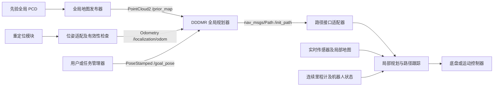

# 先验全局点云 + 重定位 + DDDMR + 局部规划器接入说明

本文面向以下已有条件：有先验全局点云地图、正在运行的重定位模块、可接收导航参考的局部规划器。
目标是用当前重定位位置作为全局规划起点，指定三维目标，由 DDDMR 生成全局路径，再交给局部规划器执行。

本文对应当前 `dddmr_ros2` 实现。重定位模块和局部规划器的实际话题名、类型尚未提供；
下文 `/localization/odom`、`/prior_map` 是接线示例，使用前应替换为实际接口。
本次新增的是接入文档及示例参数，尚未实现额外的地图发布节点、定位适配节点、导航任务管理器或局部规划器适配器。

## 1. 系统接线



各模块职责：

| 模块 | 输入 | 输出/职责 |
|---|---|---|
| 全局地图发布器 | 同一份先验 PCD | 发布固定全局坐标系下的完整 PointCloud2 |
| 重定位模块 | 先验地图与实时观测 | 当前机器人在全局地图中的位姿、TF 和定位有效性 |
| 位姿适配层 | 重定位消息 | 转成 DDDMR 支持的类型，处理参考点/坐标变换及有效性 |
| DDDMR | 全局地图、当前位置、三维目标 | 静态地图上的三维全局路径 |
| 局部规划器 | 全局参考、实时障碍物、连续机器人状态 | 局部轨迹和运动指令 |
| 任务管理器 | 目标、定位状态、路径/跟踪状态 | 决定何时允许规划、重规划、取消或停止 |

先打通“地图 + 定位 + 目标 → `/init_path`”，确认路径正确，再接入局部规划执行。
网页 `serve` 是另一套独立入口，不会自动向 ROS2 发布路径；本方案使用 `dddmr_ros2` 节点。

## 2. 接入前先确定实际接口

在已有重定位和局部规划器运行的终端环境中检查：

```bash
source /opt/ros/humble/setup.bash
ros2 topic list -t
ros2 topic info /实际重定位话题 --verbose
ros2 topic echo /实际重定位话题 --once
ros2 node info /实际局部规划器节点名
ros2 action list -t
```

记录以下内容，不要仅凭话题名判断消息类型：

1. 全局点云文件路径；是否已有地图话题；地图 frame_id、单位和 z 轴方向。
2. 重定位话题名、消息类型、频率、header.frame_id、时间戳；若为 Odometry，还要看 child_frame_id。
3. 位姿表示激光雷达、IMU、base_link 还是底盘接地点；定位失效如何表示。
4. 重定位输出是持续位姿，还是仅在首次匹配/重新定位时发布一次修正结果。
5. 局部规划器接收 Path、局部目标点、Action 还是自定义轨迹；采用哪个坐标系和高度参考。
6. 局部规划器的取消/停止接口、完成反馈、实时障碍输入和里程计输入。

## 3. 坐标系与参考点必须一致

### 3.1 全局地图坐标系

DDDMR 使用输入 PointCloud2 的 `header.frame_id` 作为规划输出坐标系。
先验地图和重定位必须描述同一套空间：相同原点、朝向、尺度、z 高度基准。
仅把 frame_id 字符串改成 `map` 不会变换 XYZ，也不会修正定位与地图的偏移。

如果重定位使用另一份裁剪/平移/旋转后的先验地图，需要给出实际刚体变换，或统一使用同一地图。
如果点云本身 z 轴倾斜，应对地图及其定位坐标作一致转换；DDDMR 的通行性判定假设 z 轴向上。

### 3.2 map、odom 与 TF

常见 TF 组织为：

```text
map → odom → base_link → lidar
```

map 提供长期全局参考，重定位修正可能造成位姿跳变；odom 提供适合局部控制的连续参考。
不要让重定位和里程计分别把同一个子坐标系发布成两个不同父节点。
这些约定见 [ROS REP-105](https://github.com/ros-infrastructure/rep/blob/master/rep-0105.rst)。

两种可接入情况：

- 重定位已输出全局坐标中的机器人位姿：直接适配为 `header.frame_id=map` 的 Odometry。
- 持续机器人位姿在 odom 中，重定位提供 map→odom：可以订阅 odom 中的 Odometry，
  当前 DDDMR 会通过 TF 把位置转换到地图坐标系。

当前实现使用**最新 TF**进行转换，并非按消息时间戳查历史变换；输入应尽量新鲜且时间源一致。
只有 TF 而没有位姿话题时，当前节点不会自行查询 map→base_link 作为起点，需适配层定时查询并发布 Odometry。

### 3.3 传感器位姿、机器人位姿、地面位置

这是本系统接线中很容易遗漏的一步：

- 雷达/IMU 位姿不等于底盘位姿，应通过已标定的外参变换。
- DDDMR 从地图提取的节点和输出 XYZ 主要位于可站立地面，起点最终会吸附到这些地面节点。
- 若输入位置位于高处的雷达或机身中心，吸附可能超范围，也可能吸到相邻楼层或平台。
- 多楼层应提供与当前地面一致的起点参考，避免靠无限增大 `snap_radius` 解决。

设重定位给出传感器 S 在地图 M 中的变换，且已知传感器到规划参考点 P 的标定关系：

```text
T_M_P = T_M_S × T_S_P
```

旋转和平移均需参与计算；坡道上不能简单对全局 z 永远减一个常数。
如果选择机器人坐标系中的地面参考点，应明确其在当前姿态下与实际接触面的关系。

当前节点只变换消息 pose.position 所在的父坐标系，**不根据 child_frame_id 自动补传感器外参**，
也不会自动将机身/雷达位置投影成正确楼层的接地点。这部分由位姿适配层处理。

局部规划器若要求 base_link 中心轨迹，而 `/init_path` 表示地面路径，路径适配层还需按其约定处理高度参考。

## 4. 重定位位姿如何接入当前节点

### 4.1 推荐：Odometry 输入

如果已有持续的 `nav_msgs/msg/Odometry`，配置：

```yaml
dddmr_planner:
  ros__parameters:
    odom_topic: /localization/odom
```

Odometry 的 pose 位于 header.frame_id 指定的坐标系；child_frame_id 描述其子参考系。
原始消息定义见 [ROS2 Humble Odometry.msg](https://github.com/ros2/common_interfaces/blob/humble/nav_msgs/msg/Odometry.msg)。

本节点读取 `msg.pose.pose.position` 和 header，缓存为下次规划起点；它不使用该消息的 twist、
协方差或定位状态，也不自动广播 TF。

**收到新里程计不会立刻重规划。** 用户发送新目标时，节点以当时缓存的最新位置启动规划。
规划已开始后到达的新里程计也不会让正在运行的路径自动失效。

### 4.2 PoseStamped 或 PoseWithCovarianceStamped 输入

| 重定位输出 | 当前节点能否直接接收 | 建议 |
|---|---|---|
| `nav_msgs/msg/Odometry` | 可以，设置 odom_topic | 优先方式 |
| `geometry_msgs/msg/PoseStamped` | 不能作为连续起点直接订阅 | 适配成 Odometry，保留正确坐标与时间 |
| `geometry_msgs/msg/PoseWithCovarianceStamped` | 可以接到 initial_pose_topic | 低频显式起点可用；高频定位流推荐转 Odometry |
| TF | 没有自动起点订阅 | TF 查询适配为 Odometry |
| 自定义重定位消息 | 不支持 | 转标准类型，并处理定位状态 |

仅改变话题名不能改变消息类型。
PoseStamped 转 Odometry 的核心字段映射如下；这只是转换片段，需在实际适配节点中运行：

```python
from nav_msgs.msg import Odometry

# 前提：pose_msg 已转换为所需规划参考点，而非未经补偿的传感器位置。
out = Odometry()
out.header = pose_msg.header
out.child_frame_id = "planning_reference"  # 必须准确描述 pose 的物理参考点
out.pose.pose = pose_msg.pose
publisher.publish(out)
```

PoseWithCovarianceStamped 转换时使用 `out.pose = input_msg.pose`。
不要把高频重定位流直接 remap 到 `/initialpose`：当前 `_on_start()` 每次都会清空路径、
使旧规划失效并触发重规划，可能导致局部规划器不断丢失参考。
而且 `/initialpose` 常用于定位模块的初始位姿输入，容易产生接口混淆。

### 4.3 仅发布一次重定位结果的情况

一次性的定位修正不能代表机器人后续持续移动的位置。
需要重定位提供 map→odom 修正，并由连续里程计更新机器人位姿，或让重定位模块持续发布全局位姿。
不要一直把首次定位结果当作运动后的当前位置。

## 5. 先验 PCD 如何送给 DDDMR

### 5.1 已有全局点云话题

直接配置为现有话题，例如 `/prior_map`，消息必须是完整 `sensor_msgs/msg/PointCloud2`，
包含 x/y/z，单位为米，frame_id 非空且含义正确。不要用逐帧激光扫描替代全局地图。

静态先验地图建议发布器采用 Reliable + Transient Local（depth=1），
并设置 DDDMR 的 `map_transient_local: true`，让晚启动的节点能取得保留地图。
若上游是 Volatile 发布器，应改用 `map_transient_local: false`，并确保订阅建立后再发布/重发地图。

### 5.2 只有 PCD 文件

当前功能包没有 PCD→话题的可执行节点。可在现有地图模块中增加发布，或另建一个小型静态地图发布器。
下面是完整的联调示例，可保存为自己的 `publish_prior_map.py`；此脚本未作为本包可执行文件安装。

```python
import argparse
import rclpy
from rclpy.node import Node
from rclpy.qos import QoSProfile, ReliabilityPolicy, DurabilityPolicy
from sensor_msgs.msg import PointCloud2
from sensor_msgs_py.point_cloud2 import create_cloud_xyz32
from std_msgs.msg import Header
from dddmr_py.pcd_io import read_pcd

parser = argparse.ArgumentParser()
parser.add_argument("pcd")
parser.add_argument("--frame", default="map")
parser.add_argument("--topic", default="/prior_map")
args = parser.parse_args()
rclpy.init(args=[])
node = Node("prior_map_publisher")
qos = QoSProfile(depth=1, reliability=ReliabilityPolicy.RELIABLE,
                 durability=DurabilityPolicy.TRANSIENT_LOCAL)
pub = node.create_publisher(PointCloud2, args.topic, qos)
cloud = create_cloud_xyz32(Header(frame_id=args.frame), read_pcd(args.pcd).xyz)

def publish():
    cloud.header.stamp = node.get_clock().now().to_msg()
    pub.publish(cloud)

publish()
timer = node.create_timer(5.0, publish)  # 保持进程存活，并低频重发同一张先验地图
try:
    rclpy.spin(node)
except KeyboardInterrupt:
    pass
finally:
    node.destroy_node()
    rclpy.try_shutdown()
```

构建并 source 工作空间后，例如：

```bash
python3 /你保存脚本的路径/publish_prior_map.py \
  /home/ros/ros_ws/pct_planner/src/dddmr_python_3d_global_planner/scenepcd/map.pcd \
  --frame map --topic /prior_map
```

只有当点云数值本来就处于该 frame 时才能直接设置这个 frame_id；否则先变换点云坐标。
静态地图使用 `update_map: false`，这样低频重发不会重复建图。

## 6. 配置与启动

### 6.1 配置文件

已提供 [reloc_ros2_example.yaml](reloc_ros2_example.yaml)，采用：

```yaml
dddmr_planner:
  ros__parameters:
    map_topic: /prior_map
    path_topic: /init_path
    goal_topic: /goal_pose
    initial_pose_topic: /dddmr/manual_start
    odom_topic: /localization/odom
    update_map: false
    map_transient_local: true
```

文件中的机器人尺寸和通行参数继承当前 `map.pcd` 演示配置，尚未根据实车标定。
示例话题名、地图 QoS 和参数要按实际系统修改。`start` 仍是代码要求的后备参数，
它不会替你检查重定位是否就绪；实车流程必须在首帧有效定位到达后才允许发目标。

### 6.2 构建和运行

```bash
source /opt/ros/humble/setup.bash
cd /home/ros/ros_ws/pct_planner
colcon build --packages-select dddmr_ros2 --symlink-install
source install/setup.bash
```

建议启动顺序：

1. 启动先验地图发布器，确认地图 frame 和 QoS。
2. 启动已有重定位/里程计节点以及外参 TF。
3. 若消息类型或参考点不匹配，启动位姿适配节点。
4. 启动 DDDMR：

```bash
ros2 launch dddmr_ros2 planner.launch.py \
  params_file:=/home/ros/ros_ws/pct_planner/src/dddmr_python_3d_global_planner/docs/reloc_ros2_example.yaml
```

5. 先保持局部规划器执行关闭，在 RViz2 检查地图、当前位姿和输出路径。
6. 确认建图日志出现 `Map ready`、已收到有效定位、TF 可用，再发布目标。
7. 路径的楼层、起点和通道符合预期后，启动路径适配器和局部规划执行。

每个新终端都需要 source ROS2 和工作空间。该示例 YAML 的 map_topic 已是 `/prior_map`，
无需额外传 `map_topic` 启动参数；如果使用通用配置，可通过参数或 remap 改为实际话题。

### 6.3 指定三维终点

以下只演示消息格式，坐标需选在实际地图可通行区域，frame_id 需改成实际地图坐标系：

```bash
ros2 topic pub --once /goal_pose geometry_msgs/msg/PoseStamped \
  "{header: {frame_id: map}, pose: {position: {x: 8.76, y: 0.94, z: 2.38}, orientation: {w: 1.0}}}"
```

DDDMR 会以最新缓存的重定位位置规划，而非以命令中的固定 `start` 规划，前提是已经收到位姿输入。
输入朝向不约束全局规划的初始/终点航向；局部规划器需要自行处理起步转向和最终朝向要求。
RViz2 的 2D 工具通常给出 z=0，跨楼层时使用显式三维目标，或有高度选择能力的交互工具。

## 7. /init_path 如何交给局部规划器

### 7.1 局部规划器直接订阅 nav_msgs/Path

如果局部规划器已支持 `nav_msgs/msg/Path`，将其路径输入配置或 remap 为 `/init_path`。
需要核实的不只是话题名：

- 局部规划器能否处理含 z 的三维路径、楼梯和坡道，以及地面法向量对齐的姿态。
- 接收的是地图坐标还是 odom 坐标，路径参考点是地面还是机身中心。
- 是否根据当前机器人位置在路径上推进进度，而非一直追逐路径第一个点。
- 是否支持新路径替换，以及收到空 Path 时的取消/停止处理。
- 是否需要带速度、加速度和时间信息的轨迹。当前 Path 不提供速度和运动时间参数化。

消息定义见 [ROS2 Humble Path.msg](https://github.com/ros2/common_interfaces/blob/humble/nav_msgs/msg/Path.msg)。
Path 中 pose 的共同时间戳只是消息时间，不表示各路点的预计到达时间。

### 7.2 只接收局部目标点或自定义轨迹

增加路径跟踪适配器：订阅 `/init_path`，维护路径及当前进度，在当前位置前方选择可跟踪目标，
转换为局部规划器要求的坐标系和消息格式。跨楼层时按路径顺序推进，避免仅用 XY 最近点切换到另一楼层。

前视距离、重采样间隔和速度限制应与局部规划器控制频率及机器人动力学匹配。
需要速度/时间轨迹时，由适配器或局部规划器完成轨迹时间参数化。

### 7.3 使用 Nav2 控制器

Nav2 控制器通常使用 `nav2_msgs/action/FollowPath`，并不会因为存在 `/init_path` 就自动开始跟踪。
需要 Action 客户端适配器把 Path 放进 FollowPath goal，并管理接收、反馈、取消和结果。
接口见 [Navigation2 Humble FollowPath.action](https://github.com/ros-navigation/navigation2/blob/humble/nav2_msgs/action/FollowPath.action)。

不要把目标只交给会调用自身全局规划器的导航入口，然后假设它在使用 DDDMR 的结果。
此外，标准二维控制/代价地图配置不能自动获得三维爬楼能力，须确认所选控制器及运动平台适用。

### 7.4 map 路径与 odom 局部控制

DDDMR 输出使用地图 frame。若局部规划器要求 odom，应由其 TF 支持或适配器进行实际坐标变换，
不能只修改 Path 的 frame_id。机器人运动或 map→odom 修正后，转换也应遵循局部规划器的更新机制。

重定位发生跳变时，要重新检查局部跟踪参考：可能需要暂停、清理旧局部轨迹、重新转换全局路径，
或从修正后的当前位置请求重规划。不要让局部控制器无条件追逐跳变前的参考。

## 8. 当前代码的触发行为和未实现能力

| 输入/事件 | 当前 DDDMR 行为 |
|---|---|
| 新目标 | 清空旧路径，以最新缓存起点发起一次规划 |
| Odometry 更新 | 更新缓存起点，不自动清路径、不自动重规划 |
| initial_pose_topic 更新 | 清路径、使旧结果失效，并对已有目标重规划 |
| 首张地图 | 后台建图；已有目标排队等待 |
| 后续地图，update_map=false | 忽略，继续使用首次地图 |
| 后续地图，update_map=true | 清路径、重建图、对已有目标重规划 |
| 无可达路径或规划异常 | 发布空 Path，并打印原因 |
| 定位停止、变旧或质量下降 | 当前节点没有专门检测机制 |
| 没收到任何定位就发目标 | 使用后备 start 参数，当前节点不会自动阻止 |

因此，当前代码能直接完成“已有有效位置 + 发目标 → 全局路径”，
完整自动导航仍需任务管理器和局部规划器的状态闭环。

当前还没有：等待有效重定位门控、位姿超时/协方差检查、定位跳变处置、自动周期重规划、
局部规划堵塞反馈、到达判断、取消 Action、实车急停逻辑。这些不能仅靠修改 YAML 自动获得。
当前多楼层地图也存在尚未解决的局部断连，详见 [已验证范围](dddmr_global_nav.md#8-mappcd-已验证结果与边界)。

## 9. 持续导航的任务管理建议

推荐的任务状态流程：

```text
等待地图 + 有效重定位 + TF + 局部规划器就绪
    → 接收目标
    → 从当前位姿规划
    → 检查非空路径并交给局部规划器
    → 跟踪执行
       ├─ 到达：结束任务
       ├─ 路径偏离/长时间受阻：从最新位姿重规划
       ├─ 新目标：取消或替换旧任务，再规划
       └─ 定位失效/明显跳变/控制异常：暂停或停止，恢复后重新校验
```

重规划时可以由任务管理器再次发布同一个最终目标到 `/goal_pose`，使当前 DDDMR 从最新位姿重新规划。
无需高频重发整张地图。还要避免重规划频率高于实际规划吞吐量，否则旧任务会持续失效。

局部动态障碍优先由局部规划器处理；当前 DDDMR 只看输入的先验地图，
局部传感器看见新障碍并不代表它会自动加入 DDDMR 的图。
任务管理器需根据局部规划器的堵塞/失败反馈决定等待、停止、请求重规划或更新地图。

定位门控至少应检查是否收到位姿、时间是否新鲜、定位质量是否有效，以及参考点是否与地图一致。
当前包没有提供这些阈值参数；相关阈值应由实际重定位模块、运动速度和控制周期确定。

## 10. 联调检查顺序

```bash
# 地图：完整 PointCloud2、正确 frame、发布器 QoS
ros2 topic info /prior_map --verbose
ros2 topic echo /prior_map --field header --once

# 位姿：持续更新、正确 frame、合理 z 和时间戳
ros2 topic info /localization/odom --verbose
ros2 topic echo /localization/odom --once

# 若采用常见 TF 组织，检查变换链（实际 frame 名可能不同）
ros2 run tf2_ros tf2_echo map base_link
ros2 run tf2_ros tf2_echo map odom

# 确认 DDDMR 订阅、参数与路径输出
ros2 node info /dddmr_planner
ros2 param get /dddmr_planner odom_topic
ros2 param get /dddmr_planner map_transient_local
ros2 topic info /init_path --verbose
ros2 topic echo /init_path --once
```

建议按以下阶段验收：

1. 静止时，RViz2 中机器人位置和先验地图对齐，z 位于正确楼层。
2. 小范围移动时，定位位置连续更新，确认不是仅收到一次重定位结果。
3. 发送同层近距离目标，检查路径起点吸附位置及整体走向。
4. 确认局部规划器确实收到新路径，并能正确处理空路径/取消。
5. 测试低速局部跟踪和实时障碍响应，再扩展到更远或跨楼层任务。
6. 验证定位失效、定位跳变和不可达目标时，执行端能停止而不是继续使用旧轨迹。

## 11. 常见接入问题

| 现象 | 优先检查 |
|---|---|
| 起点始终是固定值 | odom_topic 未配置、消息类型不匹配、QoS 不匹配、位姿尚未收到 |
| 有重定位结果但起点不随移动变化 | 重定位只发布一次；需要结合连续里程计或持续定位输出 |
| 起点漂移或与地图偏离 | map/odom 混用、两份地图原点不同、外参或坐标变换未应用 |
| 起点吸到另一楼层 | 输入的是高处传感器位置、z 基准不一致或 snap_radius 过大 |
| 路径反复被清空 | 高频定位被接到 initial_pose_topic；高频全局地图触发 update_map |
| 地图发布过但节点一直等待 | 静态地图历史样本与订阅 QoS 不匹配，或没有在订阅后重发 |
| RViz2 有路径但机器人不动 | 局部规划器未接 Path/Action 适配，或状态/控制接口未就绪 |
| 已移动但全局路径没有更新 | 当前设计不随 Odometry 自动重规划；需要任务管理触发 |
| 局部障碍挡路仍输出相同全局路径 | DDDMR 用静态先验地图，动态障碍需由局部层或地图更新处理 |
| 定位丢失仍能生成路径 | 当前没有定位超时门控，可能继续使用旧缓存位置 |
| 空 Path 后仍继续运动 | 局部规划器未实现空路径取消/停止，需在执行接口补齐 |

相关文档：[完整使用方法](dddmr_global_nav.md)、[ROS2 地图演示参数](map_ros2_example.yaml)。
